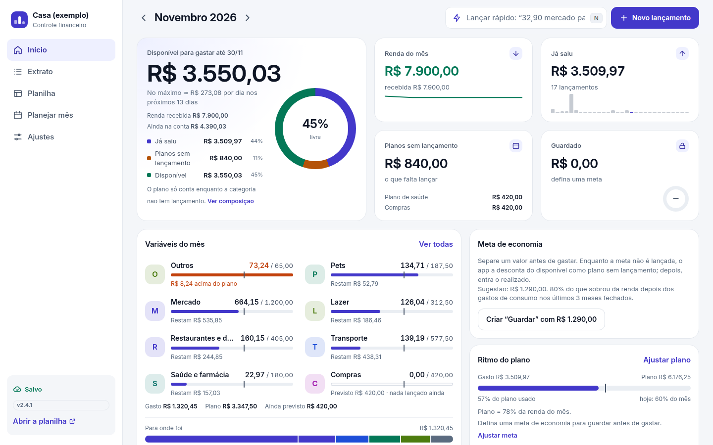
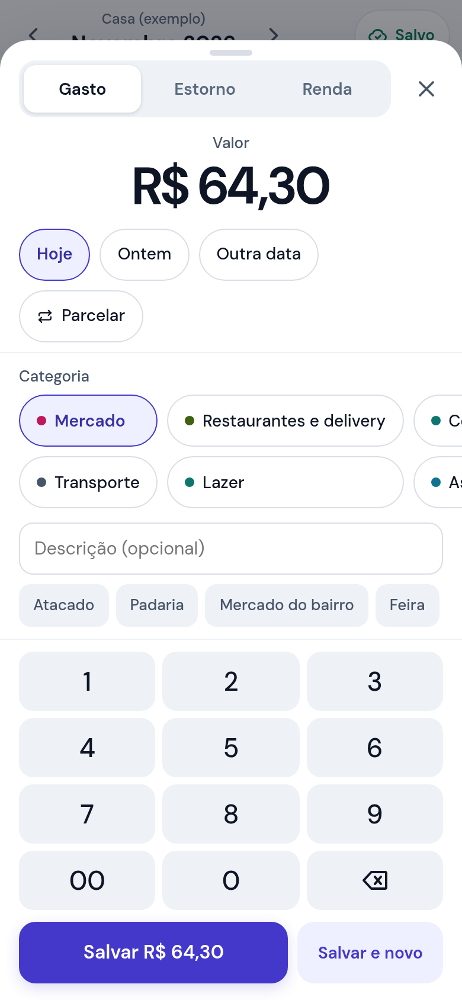
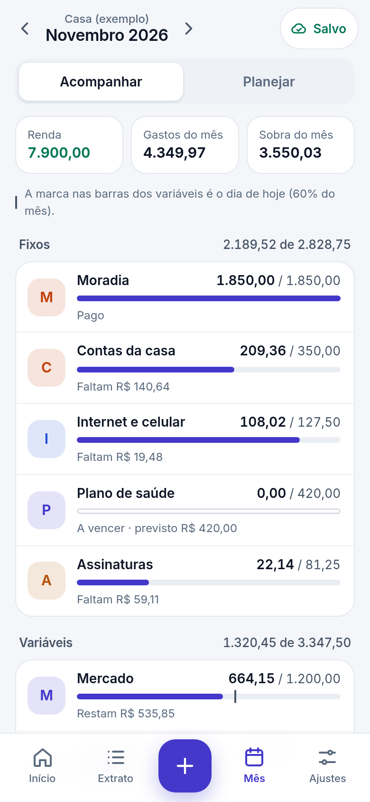

<p align="center">
  
</p>

<h1 align="center">Finanças</h1>

<p align="center"><sub>um projeto <a href="https://github.com/bsdesenv">bsdesenv</a></sub></p>

<p align="center">
  <strong>Seu controle financeiro, dentro do seu Google Sheets.</strong><br>
  Lance em segundos no celular, planeje no computador e mantenha os dados na sua planilha.<br>
  <sub>Sem mensalidade, sem anúncio, sem servidor de terceiros.</sub>
</p>

<p align="center">
  <a href="CHANGELOG.md"></a>
  <a href="LICENSE"></a>
  
  
</p>

<p align="center">
  <a href="docs/INSTALAR.md"><strong>Instalar</strong></a> ·
  <a href="docs/USAR.md">Como usar</a> ·
  <a href="https://www.youtube.com/playlist?list=PLOrq0JTHxh_A">Tutoriais em vídeo</a>
</p>

<p align="center">
  
</p>

> **A regra em uma frase:** cada categoria conta pelo que foi lançado; se ainda não teve lançamento, vale o plano. O **disponível** é renda − o que já saiu − os planos sem lançamento.

## Destaques

- **Sua planilha, no seu Drive.** Sem servidor, mensalidade ou anúncio.
- **Lançamento em segundos.** `32,90 mercado padaria` + `Enter`; no celular, `+`.
- **Tudo na tela.** Disponível, ritmo, meta e cobertura do plano.
- **Sincronizado.** Celular e computador não se sobrescrevem; offline funciona.
- **Acessível.** Contraste AA, toque de 44 px e teclado.

## Comece em 10 minutos

Sem programar: são três passos e uns 10 minutos.

1. **Crie uma planilha** em [sheets.new](https://sheets.new).
2. **Cole os arquivos** de [`src/`](src) em **Extensões › Apps Script**.
3. **Publique** como **App da Web**, com *Executar como: Eu* e *Quem pode acessar: Somente eu*.

[Passo a passo completo](docs/INSTALAR.md) · [Problemas comuns](docs/INSTALAR.md#problemas-comuns) · [Já uso a versão 1](docs/ATUALIZAR.md)

## Veja por dentro

<p align="center">
  
  
  
</p>

| Planilha com mapa de calor | Modo escuro |
|---|---|
|  |  |

| Extrato no celular | Primeiro acesso |
|---|---|
|  |  |

<p align="center"><sub>Imagens ilustrativas, com dados fictícios.</sub></p>

## Como funciona

A planilha é a fonte da verdade: `lancamentos`, `categorias`, `orcamento` e `config`. O app envia operações pequenas e o servidor aplica sobre a planilha atual. Detalhes em [docs/ARQUITETURA.md](docs/ARQUITETURA.md).

## Privacidade

- Roda na sua conta, com acesso só seu.
- Permissão apenas para esta planilha (`@OnlyCurrentDoc`).
- Os dados ficam no seu Google Drive e não passam por outro servidor.
- Texto que viraria fórmula é gravado como texto.

<details>
<summary><strong>Desenvolvimento</strong></summary>

```
src/          arquivos do Apps Script (é o que vai para o projeto)
testes/       servidor rodando no Node sobre uma planilha falsa, e testes no navegador
exemplos/     dados fictícios para experimentar e para os testes
docs/         guias e imagens
```

As versões ficam marcadas como tags (`v2.1.0`...) e o que mudou em cada uma está no [CHANGELOG.md](CHANGELOG.md).

```bash
npm test             # testes do servidor (Node 20+, sem dependências)
npm i -D puppeteer   # uma vez, para os testes no navegador
npm run test:e2e     # o app de verdade num Chrome sem janela, falando com o servidor de verdade
npm run prints       # regrava os prints de docs/img com os dados fictícios
npm run preview      # prévia local em http://localhost:4173, sem publicar no Apps Script
npm run preview:prints  # prints de PC e celular em testes/saida/preview/
```

A prévia usa os dados fictícios de `exemplos/dados-exemplo.json`. Para ver o seu backup sem enviar nada ao Google, rode `npm run preview -- --data=caminho/do/backup.json`.

Para enviar o código direto para o Apps Script, use o [clasp](https://github.com/google/clasp): copie `.clasp.json.example` para `.clasp.json`, preencha o `scriptId` do seu projeto e rode `npx clasp push`.

</details>

## Licença

[MIT](LICENSE) · feito por [bsdesenv](https://github.com/bsdesenv)
