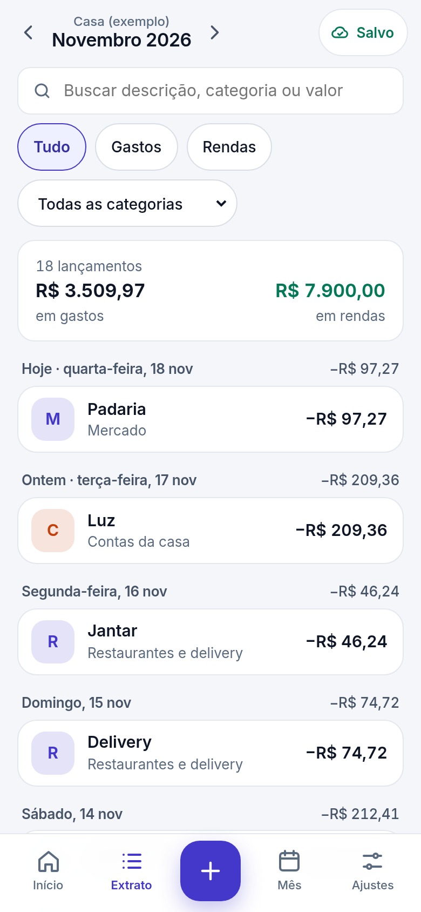

# bsdesenv-financas

Controle financeiro pessoal que roda no **Google Sheets + Apps Script**: rápido para lançar no celular, completo no computador, e com os seus dados numa planilha da sua própria conta Google.

*Personal finance tracker built on Google Sheets + Apps Script (Portuguese UI). Your data stays in your own spreadsheet.*

<p>
  
  
  
</p>


## Por que usar

- **Seus dados, sua planilha.** Tudo fica numa planilha do seu Google Drive, em abas comuns que dá para abrir e ler. Sem servidor de terceiros, sem mensalidade, sem anúncio e sem senha de banco.
- **Lançar em três toques.** O botão **+** fica sempre à mão. O valor se digita como no app do banco (6430 vira R$ 64,30), as categorias mais usadas vêm primeiro e a data já começa em "hoje".
- **Previsão honesta.** "Livre para gastar até o fim do mês", ritmo do mês e uma projeção que não fica otimista só porque o mês ainda não acabou.
- **Planilha no computador.** O ano inteiro numa matriz com mapa de calor (onde cada categoria fugiu da própria média), atalhos de teclado e lançamento direto na célula.
- **Não perde nada.** Celular e computador podem ser usados ao mesmo tempo sem um apagar o outro. Sem conexão, o app guarda no aparelho e envia depois. Toda exclusão tem "Desfazer".
- **Acessível.** Contraste AA nos temas claro e escuro, alvos de toque de 44 px e navegação completa pelo teclado.

## Telas

| Planilha com mapa de calor | Modo escuro |
|---|---|
|  |  |

| Extrato | Primeiro acesso |
|---|---|
|  |  |

## Instalar

São uns 10 minutos, tudo no navegador e sem instalar nada:

1. Crie uma planilha em <https://sheets.new>.
2. Em **Extensões › Apps Script**, cole os arquivos da pasta [`src/`](src).
3. Faça **Implantar › Nova implantação › App da Web**, com *Executar como: Eu* e *Quem pode acessar: Somente eu*.
4. Abra o endereço que termina em `/exec`. No celular, use **Adicionar à tela inicial**.

O passo a passo completo, com os nomes exatos dos arquivos, está em **[docs/INSTALAR.md](docs/INSTALAR.md)**.

**Já usa a versão 1?** A versão 2 lê as mesmas abas, com as mesmas colunas, sem migração nenhuma. Veja **[docs/ATUALIZAR.md](docs/ATUALIZAR.md)**.

**Quer só experimentar?** Depois de instalar, vá em **Ajustes › Importar backup** e escolha [`exemplos/dados-exemplo.json`](exemplos/dados-exemplo.json): um ano de dados fictícios.

## Como funciona

A planilha é a fonte da verdade, em quatro abas legíveis:

| Aba | O que tem |
|---|---|
| `lancamentos` | uma linha por gasto ou renda: id, ano, mês, dia, categoria, descrição, valor |
| `categorias` | nome, grupo (fixo, variável ou renda) e ordem |
| `orcamento` | o plano de cada categoria em cada mês |
| `config` | nome do controle, tema e a revisão usada na sincronização |

O app nunca regrava a base inteira. Ele envia **operações** (salvar ou apagar um lançamento, mudar um plano...) e o servidor as aplica sobre o que está na planilha naquele momento. Detalhes em [docs/ARQUITETURA.md](docs/ARQUITETURA.md).

## Privacidade e segurança

- O app roda **na sua conta**, com acesso **somente seu**. Ninguém mais abre o endereço.
- A permissão pedida ao Google é **"somente esta planilha"** (`@OnlyCurrentDoc`), não todas as suas planilhas.
- O Google mostra o aviso "app não verificado" porque o script é seu e não foi publicado na loja. O código é o deste repositório.
- Requisições externas: só a fonte Inter (Google Fonts) e o ícone da aba (este repositório no GitHub).
- Texto que viraria fórmula na planilha (começando com `=`, `+`, `-` ou `@`) é gravado como texto.

## Desenvolvimento

```
src/          arquivos do Apps Script (é o que vai para o projeto)
testes/       servidor rodando no Node sobre uma planilha falsa, e testes no navegador
exemplos/     dados fictícios para experimentar e para os testes
docs/         guias e imagens
```

```bash
npm test             # testes do servidor (Node 20+, sem dependências)
npm i -D puppeteer   # uma vez, para os testes no navegador
npm run test:e2e     # o app de verdade num Chrome sem janela, falando com o servidor de verdade
npm run prints       # regrava os prints de docs/img com os dados fictícios
```

Para enviar o código direto para o Apps Script, use o [clasp](https://github.com/google/clasp): copie `.clasp.json.example` para `.clasp.json`, preencha o `scriptId` do seu projeto e rode `npx clasp push`.

## Licença

[MIT](LICENSE)
