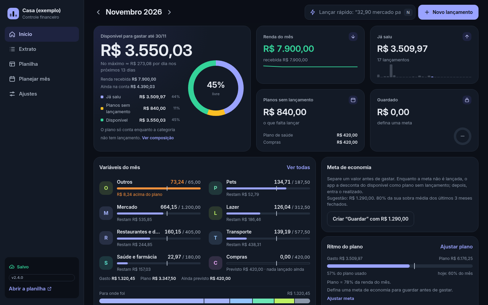

<p align="center">
  
</p>

<h1 align="center">Finanças</h1>

<p align="center">
  <strong>Saiba quanto você ainda pode gastar este mês.</strong><br>
  Controle financeiro no celular e no computador, com tudo guardado numa planilha do seu Google Drive.<br>
  <sub>Gratuito. Sem mensalidade, sem anúncio, sem cadastro em outro site.</sub>
</p>

<p align="center">
  <a href="#comece-em-2-minutos"><strong>Começar agora</strong></a> ·
  <a href="docs/USAR.md">Como usar</a> ·
  <a href="https://www.youtube.com/playlist?list=PLOrq0JTHxh_A">Vídeos</a>
</p>

<p align="center">
  
</p>

## O que ele faz por você

- **Um número que responde tudo.** O Início mostra quanto dá para gastar até o fim do mês, já descontando as contas e o que você planejou.
- **Lançar leva segundos.** Digite `32,90 mercado` e pronto. No celular, toque no **+**.
- **Planeje o mês.** Diga quanto quer gastar em cada categoria e veja se está no ritmo.
- **Gastou menos? Libere a sobra.** Quando uma conta vem mais barata ou um plano termina antes, um toque em **Liberar** devolve a sobra ao que você pode gastar. Perto do fim do mês, o app lembra de revisar.
- **Contas e cartão em dia.** Veja o que falta pagar, as faturas do cartão e as compras parceladas.
- **Traga o extrato do banco.** Importe o arquivo do banco em vez de digitar tudo.
- **Feche o mês.** O app mostra o que ficou pendente e leva o que sobrou para o mês seguinte.

## Veja como é

<p align="center">
  
  
  
</p>

| O ano inteiro numa tela | Modo escuro |
|---|---|
|  |  |

<p align="center"><sub>Imagens com dados fictícios.</sub></p>

## Comece em 2 minutos

1. **Abra o [instalador do Finanças](https://script.google.com/macros/s/AKfycbwjAGEw8zZ_ju1NImYSjU539npZRQPM48cl-tgJLugXVe0gxE0lkx_gKmEi3DIL6wFzZA/exec)** e entre com a sua conta Google.
2. **Dê um nome à planilha** e clique em **Instalar**. Leva uns 20 segundos.
3. **Abra o Finanças** e escolha um modelo de categorias.

Quer só olhar antes? No primeiro acesso, use os **dados de exemplo**: explore à vontade, nada é gravado.

O Google pode mostrar um aviso de "app não verificado". É esperado em apps pessoais; o [passo a passo](docs/INSTALAR.md#instalar-com-o-instalador-recomendado) mostra o que clicar.

Antes de começar, a página `docs/index.html` (publicada pelo GitHub Pages quando ligado) mostra o que vai acontecer. No fim da instalação, um QR code leva o endereço do app ao celular.

## Seus dados são seus

- Tudo fica numa planilha no seu Google Drive. Você abre, copia ou apaga quando quiser.
- O app só enxerga essa planilha, e nada passa por outro servidor.
- Celular e computador ficam sincronizados. Se a internet cair, os lançamentos esperam e sobem quando ela voltar.
- Quando sai uma versão nova, o app avisa e atualiza num clique, guardando antes uma cópia de segurança.

Detalhes em [Segurança e privacidade](docs/SEGURANCA.md).

<details>
<summary><strong>Para desenvolvedores</strong></summary>

```
src/          arquivos do Apps Script (é o que vai para o projeto)
instalador/   projeto Apps Script que instala e atualiza o Finanças
testes/       servidor no Node sobre uma planilha falsa, e testes no navegador
exemplos/     dados fictícios para experimentar e para os testes
docs/         guias e imagens
```

```bash
npm test             # testes do servidor (Node 20+)
npm run test:e2e     # o app num Chrome sem janela, falando com o servidor de verdade
npm run preview      # prévia local em http://localhost:4173, com dados fictícios
```

Como o app funciona por dentro: [docs/ARQUITETURA.md](docs/ARQUITETURA.md). Instalar à mão: [docs/INSTALAR.md](docs/INSTALAR.md#instalar-à-mão).

</details>

## Licença

[MIT](LICENSE) · feito por [bsdesenv](https://github.com/bsdesenv)
