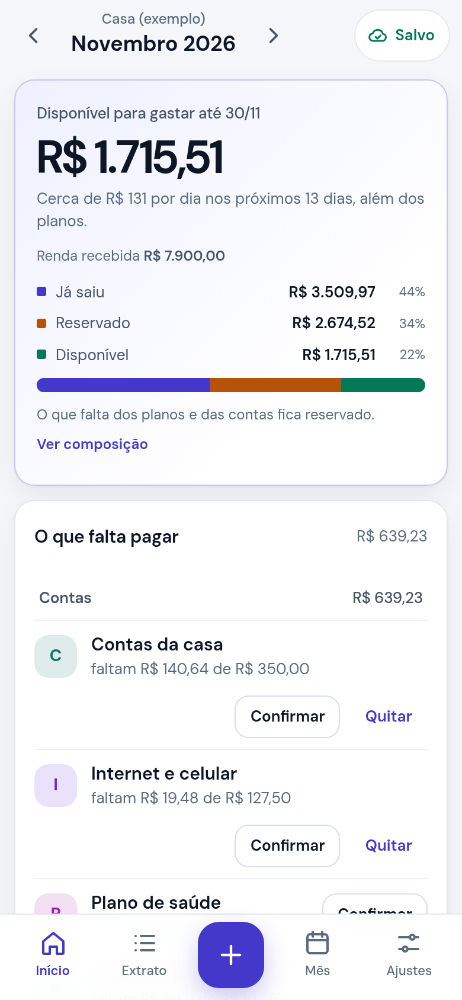
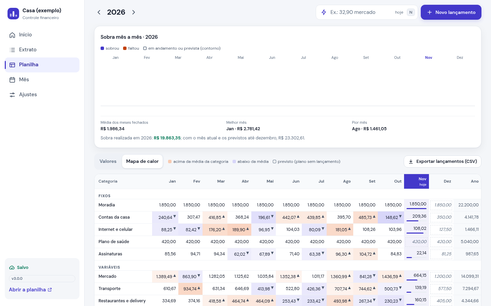
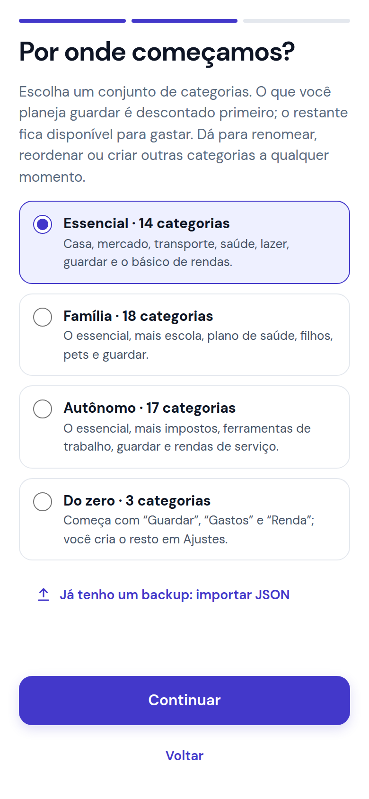

<p align="center">
  
</p>

<h1 align="center">Finanças</h1>

<p align="center"><sub>um projeto <a href="https://github.com/bsdesenv">bsdesenv</a></sub></p>

<p align="center">
  <strong>Seu controle financeiro, dentro do seu Google Sheets.</strong><br>
  Interface renovada para PC e celular: lance em segundos, planeje com clareza e mantenha os dados na sua planilha.<br>
  <sub>Sem mensalidade, sem anúncio, sem servidor de terceiros.</sub>
</p>

<p align="center">
  <a href="CHANGELOG.md"></a>
  <a href="LICENSE"></a>
  
  
</p>

<p align="center">
  <a href="docs/INSTALAR.md"><strong>Instalar</strong></a> ·
  <a href="docs/USAR.md">Como usar</a> ·
  <a href="https://www.youtube.com/playlist?list=PLOrq0JTHxh_A">Tutoriais em vídeo</a>
</p>

<p align="center">
  
</p>

> **A regra em uma frase:** o **disponível** é a renda do mês − o que já saiu − o que ainda está reservado: as contas a pagar, o que falta guardar e o que resta dos planos. Gastar dentro de um plano não muda o disponível, e receber parte de uma renda prevista também não.

## Destaques

- **Sua planilha, no seu Drive.** Sem servidor, mensalidade ou anúncio.
- **Lançamento em segundos.** `32,90 mercado padaria` + `Enter`; no celular, `+`.
- **Início por perguntas.** Quanto dá para gastar, o que falta pagar, como estão os planos e para onde foi o dinheiro.
- **Fechamento do mês.** Veja as pendências e feche o mês com a sobra realizada.
- **Escolha o mês num toque.** Toque no nome do mês e vá direto a ele.
- **Dados de exemplo.** Explore o app antes de começar. Nada é gravado.
- **Sincronizado.** Celular e computador não se sobrescrevem; offline funciona.
- **Acessível.** Contraste AA, toque de 44 px e teclado.
- **Atualiza em um clique.** O app avisa quando há versão nova; você confirma e o instalador troca o código, guardando antes uma cópia de segurança. Quem preferir atualiza à mão.

## Novidades da versão 3.0.0

- **Início por perguntas.** O Início responde, nesta ordem: quanto posso gastar, o que falta pagar, como estou nos planos e para onde foi o dinheiro. O gráfico do ano foi para a Planilha.
- **Fechar o mês.** Num mês que passou, as pendências aparecem uma a uma. Ao fechar, o mês guarda a sobra realizada.
- **Escolher o mês num toque.** Toque no nome do mês, escolha na grade e copie o link do mês.
- **Ver com dados de exemplo.** No primeiro acesso, explore um controle fictício. Nada é gravado.
- **Planejar com retorno.** O plano mostra quando foi salvo, e "Copiar de" traz o plano ou o que foi lançado.
- **Fonte e cores.** A DM Sans vem com o app, e cada categoria ganha uma cor pela posição na lista.

## Novidades da versão 2.7.0

- **Instalação em um clique.** O [instalador](https://script.google.com/macros/s/AKfycbwjAGEw8zZ_ju1NImYSjU539npZRQPM48cl-tgJLugXVe0gxE0lkx_gKmEi3DIL6wFzZA/exec) cria a planilha, o projeto e a publicação no seu Drive em uns 20 segundos. Quem preferir continua instalando à mão.
- **Atualização em um clique.** Em **Ajustes › Atualizações**, **Atualizar agora** troca o código mantendo o mesmo endereço, depois de guardar uma cópia de segurança.
- **Aviso de versão nova.** Uma vez por dia o navegador consulta o arquivo público de versões no GitHub e acende um ponto em **Ajustes**. A consulta não envia dados seus e pode ser desligada.
- **Atualização à mão, guiada.** **Atualizar à mão…** copia cada arquivo, conferido por SHA-256, para você colar no editor.

**Atualização 2.6.x:** o tema azul/índigo voltou e o layout de PC, tablet e celular foi refinado.

As regras financeiras permanecem iguais. Veja os detalhes no [changelog](CHANGELOG.md) e no guia [Como usar](docs/USAR.md).

## Comece em 2 minutos

1. **Abra o [instalador do Finanças](https://script.google.com/macros/s/AKfycbwjAGEw8zZ_ju1NImYSjU539npZRQPM48cl-tgJLugXVe0gxE0lkx_gKmEi3DIL6wFzZA/exec)** e autorize com a sua conta Google.
2. **Escolha o nome da planilha** e clique em **Instalar** (leva uns 20 segundos).
3. **Abra o Finanças** e faça o primeiro acesso.

Se o Google mostrar o aviso de app não verificado, o passo a passo está em [Instalar](docs/INSTALAR.md#instalar-com-o-instalador-recomendado).

**Prefere instalar sem o instalador?** Dá para fazer à mão, em uns 10 minutos: crie a planilha, cole os arquivos de [`src/`](src) e publique como App da Web. Está em [Instalar à mão](docs/INSTALAR.md#instalar-à-mão).

[Passo a passo completo](docs/INSTALAR.md) · [Problemas comuns](docs/INSTALAR.md#problemas-comuns) · [Já uso a versão 1](docs/ATUALIZAR.md)

## Veja por dentro

<p align="center">
  
  
  
</p>

| Planilha com mapa de calor | Modo escuro |
|---|---|
|  |  |

| Extrato no celular | Primeiro acesso |
|---|---|
|  |  |

<p align="center"><sub>Imagens ilustrativas, com dados fictícios.</sub></p>

## Como funciona

A planilha é a fonte da verdade: `lancamentos`, `categorias`, `orcamento` e `config`. O app envia operações pequenas e o servidor aplica sobre a planilha atual. Detalhes em [docs/ARQUITETURA.md](docs/ARQUITETURA.md).

## Privacidade

- Roda na sua conta, com acesso só seu.
- O app pede permissão apenas para esta planilha (`@OnlyCurrentDoc`). O instalador tem permissões próprias e não lê seus dados; veja [Segurança](docs/SEGURANCA.md).
- Os dados ficam no seu Google Drive e não passam por outro servidor.
- Texto que viraria fórmula é gravado como texto.
- A consulta de versão é uma leitura pública do GitHub, sem enviar dados; o GitHub vê o IP, como em qualquer site. Detalhes em [Segurança e privacidade](docs/SEGURANCA.md).

<details>
<summary><strong>Desenvolvimento</strong></summary>

```
src/          arquivos do Apps Script (é o que vai para o projeto)
instalador/   projeto Apps Script separado que instala e atualiza o Finanças
testes/       servidor rodando no Node sobre uma planilha falsa, e testes no navegador
exemplos/     dados fictícios para experimentar e para os testes
docs/         guias e imagens
versao.json   canal de versões lido pelo app (versão, tag, novidades e SHA-256)
```

As versões ficam marcadas como tags (`v2.1.0`...) e o que mudou em cada uma está no [CHANGELOG.md](CHANGELOG.md). O workflow [`.github/workflows/publicar-versao.yml`](.github/workflows/publicar-versao.yml) roda os testes e cria a tag e o Release quando a versão muda na `main`.

```bash
npm test             # testes do servidor (Node 20+, sem dependências)
npm i -D puppeteer   # uma vez, para os testes no navegador
npm run test:e2e     # o app de verdade num Chrome sem janela, falando com o servidor de verdade
npm run prints       # regrava os prints de docs/img com os dados fictícios
npm run preview      # prévia local em http://localhost:4173, sem publicar no Apps Script
npm run preview:prints  # prints de PC e celular em testes/saida/preview/
```

A prévia usa os dados fictícios de `exemplos/dados-exemplo.json`. Para ver o seu backup sem enviar nada ao Google, rode `npm run preview -- --data=caminho/do/backup.json`.

</details>

## Licença

[MIT](LICENSE) · feito por [bsdesenv](https://github.com/bsdesenv)
